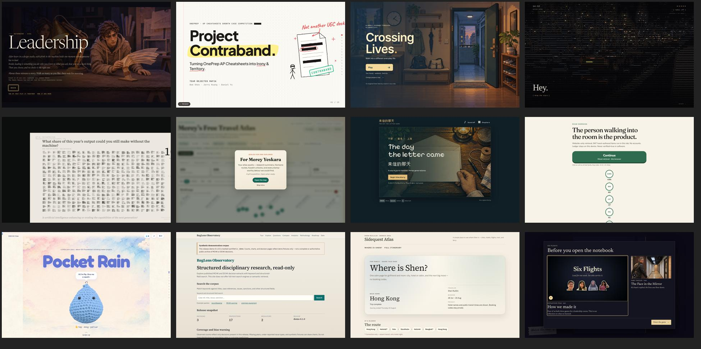
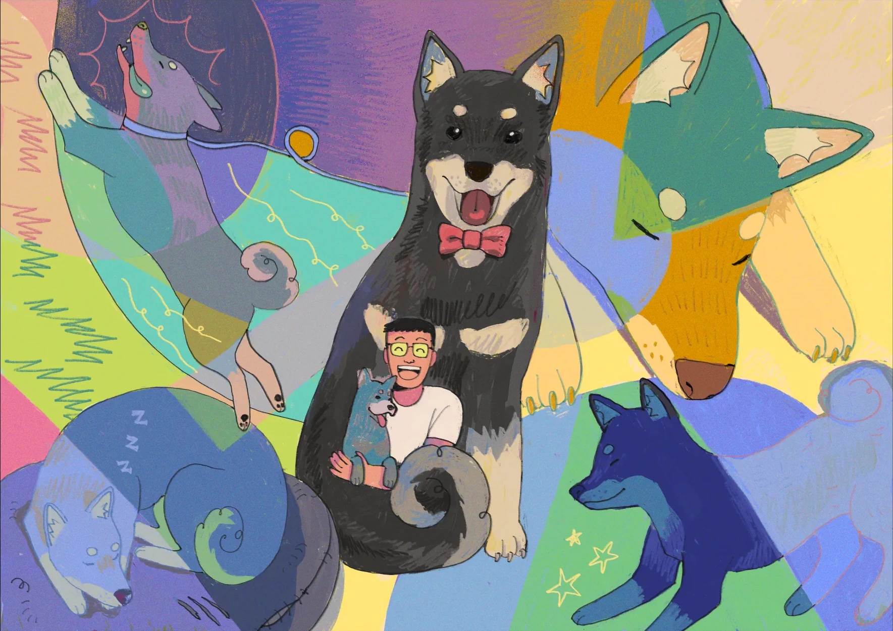
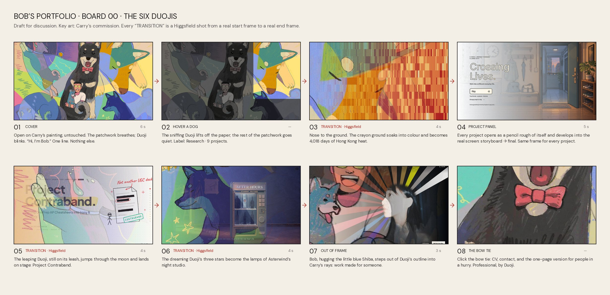

# Back to the drawing board

**Status, 27 November:** planning only. Nothing is built from this yet. The gate ([where-next](where-next.md)) is set aside as one earlier idea, not the plan.

## What Bob asked for

- **A theme for the whole thing: a storyboard.** It runs across the many projects on Bob’s GitHub and across many different effects.
- **Higgsfield as the king of transitions.** It can also make 3D models, so set goals for Astra.
- **A professional’s comment:** be *more professional, more versatile and more creative at the same time*, held together by one consistent theme.
- **Carry’s commission for Bob as the page, or parts of it.** Different parts lead to different things, because Duoji is a big part of his life.
- **Things he loves:** Doraemon. SpongeBob, because he’s Bob and a sponge absorbs so much. The CV could be visualised too.
- **References:** two reels so far, with more links to come.

## What the research says

### Bob’s two reels

Both are by [taoagou 陶阿狗君](https://www.instagram.com/reel/DN7ho4lDC7a/). One is tagged “out-of-screen costume change”, captioned *Welcome to my domain*. The other ([1.6M likes](https://www.instagram.com/reel/DNras-5XqSP/)) is tagged “interactive video” and “finger game”: the person in the video plays with the viewer’s finger, like a cat toy. Neither post says how it was made. Commenters guessed Blender and After Effects.

**The spirit to carry:** the frame isn’t a wall. Something steps out of the screen to meet you, it reacts to *you*, and every change lands on a beat. Translated for Bob:
- Duoji in the painting watches and chases your cursor or finger.
- Projects don’t sit in boxes: something from each one steps out of its frame.

### Why Carry’s site works, and what “professional” means

- **First impressions are fast.** People form stable judgements of a website’s attractiveness within about 50 ms ([Lindgaard et al., 2006](https://research.google/pubs/the-role-of-visual-complexity-and-prototypicality-regarding-first-impression-of-websites-working-towards-understanding-aesthetic-judgments/)).
- **Simple and familiar wins at a glance.** Low visual complexity and high *prototypicality* (looking like what a site of that kind is expected to look like) were judged most appealing, with effects within 17–50 ms ([Tuch et al., 2012](https://research.google.com/pubs/archive/38315.pdf); [Google’s summary](https://research.google/blog/users-love-simple-and-familiar-designs-why-websites-need-to-make-a-great-first-impression/)).
- **Carry’s site follows both.** One unforgettable image, three phrases, and a structure everyone already understands (stories: tap, hold, swipe).

**The lesson for “professional *and* creative”:** be wild in the picture and familiar in the structure. The creativity lives in the art and the transitions. The professionalism lives in a frame that never changes: the same panel, the same labels (role, year, what it is, what happened) and the same controls for every project.

### Bob’s GitHub

There are 37 public repositories. Twelve have live sites, captured below. Every one has a completely different look: dark editorial, case-competition deck, pixel game, ASCII city, crochet raindrop, research observatory, travel notebook. That is the *versatile* part, and also why the site needs one frame that holds them all without flattening them.

### The commission

Carry painted Duoji six times, in her own language: flat planes of colour, crayon texture, and shapes that overlap and show through each other.

| | Duoji | Reads as |
| --- | --- | --- |
| **Centre** | Sitting tall in a red bow tie, mouth open, with **Bob inside his outline**, laughing and hugging a small blue Shiba | Who Bob is. *The bow tie is the brief in one picture: professional and playful at once.* |
| **Top left** | Leaping on his leash, howling at a dark circle ringed with a red sunburst | Ambition, and barking at things bigger than himself (the real Duoji does) |
| **Top right** | A huge head, eyes shut, nose to the ground | Following a scent: curiosity |
| **Bottom left** | Curled up asleep, *zzz* | Rest, the quiet things |
| **Bottom right** | Lying content, three yellow stars beside him | Dreaming |
| **Behind him** | A pale outline Duoji, not yet coloured in | Still being drawn. *It is literally a storyboard sketch inside the painting.* |

## The theme: the six Duojis, as a storyboard

**The painting is the cover and the map. The storyboard is the frame. Higgsfield is the cut between shots.**

1. **Cover.** Carry’s painting, full screen, with one line (*Hi, I’m Bob.*). The patchwork breathes, Duoji blinks and his eyes follow your cursor.
2. **Map.** Each Duoji is a chapter. Hover or touch one and it lifts off the paper while the rest goes quiet, with the chapter name and how many projects it holds.
3. **The cut.** Choose a Duoji and it *does its thing* into the chapter. That is a Higgsfield transition from a real frame of the painting to a real frame of the work: the sniffer’s nose goes into the ground and the ground becomes the heat data; the leaper jumps through the moon onto a stage.
4. **The board.** Inside a chapter, each project is a storyboard panel, always in the same frame: number, title, role, year, one line, what happened. Each panel opens as a pencil rough of itself and develops into the real screen (rough → final). Its own colours and type stay inside the panel.
5. **The bow tie** is always there: CV, contact, and a one-page version for people in a hurry.

### First sort of the projects (for Bob to rearrange)

| Duoji | Chapter | Projects (from GitHub and the CV) |
| --- | --- | --- |
| Sniffing | **Follows the scent**: research | Heat & health (Laidlaw), AERIS-HK, RegLens Observatory, Silicon Atlas, BIOC1600 aptamer biosensor and *Save the Signal*, One Health Lab, Care Gap HK, HKO/PolyU atmospheric rivers (CV) |
| Leaping | **Bigger than he is**: competitions and pitches | Project Contraband, MIT Solve 2027, Cathay 2026, hackathons, Physics Tournament, AI racing, World Scholars’ Cup (CV) |
| Dreaming | **Worlds**: stories and games | Asterwind, Crossing Lives (the game), *The Day the Letter Came*, GTA-ASCII, NEWDAY *Keep the Seam*, *Six Flights* |
| Bob and the little Shiba | **Made for someone** | Carryistic, Merey’s Free Travel Atlas, Pocket Rain, Jamie’s Crossing Lives site, Sidequest Atlas, LINK-S, Career Atlas |
| Sleeping | **Quiet things**: learning and habits | Poems, MCAT–GAMSAT retrieval, LearnAI, My-Life, Keyboard Piano |
| Outline | **Still being drawn**: in progress | Orbit (iOS), Emergence, anything unfinished, and the storyboard of this site itself |
| Centre, bow tie | **Bob** | About, CV, contact |

### Effects, each with one job

| Effect | Its job | Made with |
| --- | --- | --- |
| **Living painting** | Each Duoji moves a little (breathing, a leash swinging, stars twinkling), keeping Carry’s lines | Higgsfield image-to-video, start = end = Carry’s frame |
| **Duoji watches you** | The cursor or finger as a toy, in the taoagou spirit | Higgsfield head-turn frames from her Duoji, played by cursor position |
| **The cut** | Each Duoji’s action carries into its chapter | Higgsfield start and end frames (the king of transitions) |
| **Rough → final** | One consistent reveal for every project, which shows process | The rough is traced from the real capture in code; Higgsfield develops it into the real frame |
| **Out of frame** | Something from a project steps into the page: Pip the raindrop drips out of Pocket Rain, a pixel door opens out of Crossing Lives | Higgsfield, plus background removal |
| **3D Duoji** | A figure you can turn, on the About page | Higgsfield image-to-3D from the centre Duoji (Meshy 7, Tripo or Hunyuan3D). Quadruped rigging is weak, so it is a turntable, not a walker. |
| **Soak** | The sponge idea: colour wicks through the paper between chapters. Water also runs through Bob’s work: heat, atmospheric rivers, Macha’s water interviews, Pocket Rain. | Code (a paper-wicking shader) or Higgsfield |
| **The CV as a walk** | The CV drawn as Duoji’s route on his leash, one stop per year | Code, drawn in Carry’s palette |

### Other ways to go

- **B · The board only.** No painting. The site *is* a director’s storyboard: rows of panels, rough to final, Higgsfield cuts between them. Very professional, less personal.
- **C · Out of the screen.** Pushes the taoagou spirit to the front: every project shown on a device, and something always steps out of it. The most viral, but the hardest to keep professional.
- **D · The sponge.** Water is the thread, and everything Bob absorbs is shown as colour soaking in. Quiet and poetic, but abstract for a first visit.

The recommendation is the six Duojis as a storyboard, borrowing C’s transitions and D’s soak.

## What we borrow and what we don’t

- **Carry’s painting** is the heart of it, so **Carry should agree** before it is cut into layers, animated or turned into 3D. New Duoji art should be *drawn by Carry*, as a paid extension, not generated “in her style”. A professional site can’t rest on an imitation of the artist who made its cover.
- **Doraemon and SpongeBob:** the *ideas* (a pocket of endless gadgets, a door to anywhere, a sponge that absorbs everything), never the characters or their look. Licensed characters would also make the site *less* professional.
- **taoagou:** the spirit (crossing the frame, reacting to the viewer), not their footage or edits.

## Goals for Astra: five tests before any build

Each answers one question, using a real frame at both ends.

1. **Can Carry’s lines survive motion?** Animate the sleeping Duoji: four seconds of breathing, looped. Fail if a crayon stroke swims.
2. **Is a cut as good as a cut can be?** Sniffing Duoji → heat data, four seconds, three takes.
3. **Can Duoji watch you?** A 5 × 3 grid of head turns for the centre Duoji, from her painting.
4. **Is 3D Duoji charming or uncanny?** Image-to-3D of the centre Duoji with texture, as a turntable render.
5. **Does rough → final read as process?** One project (Crossing Lives, the game), five seconds.

## Questions for Bob

1. **The commission file.** Can Carry send the original at full size, and ideally the **layered** file (Procreate or PSD)? Layers decide whether each Duoji can move on its own.
2. **Carry’s yes.** Will she agree to the painting being cut up, animated and made 3D? Would she draw a few more Duoji poses or storyboard roughs for the site (paid)?
3. **Jerry.** You said “Jerry does have one”. Is that Jerry Huang from Project Contraband? What does he have: an artwork, a site, a reference?
4. **The six Duojis.** What does each mean to you? Is the leaper howling at the moon or the sun? Is the pale outline Duoji someone? Is the little blue Shiba you’re hugging one of the plushies he eats the ears off?
5. **The reels.** What grabbed you most: the step out of the screen, the reaction to your finger, the costume change on the beat, or the sound?
6. **The cut list.** Which 6–8 projects are you proudest of? Are there any to hide?
7. **The professional.** Who said it (a designer, a recruiter, a professor), and what were they looking at?
8. **Doraemon.** Which part do you mean: the Anywhere Door, the 4D pocket, the gadgets, the friendship? And for the sponge: is it “I absorb everything”, or water itself?
9. **Who it must win.** Admissions readers, people who’d hire you to build, or a research supervisor? This decides which Duoji comes first.
10. **More links.** Send every reference you love, and one site you can’t stand. The second is often more useful.
