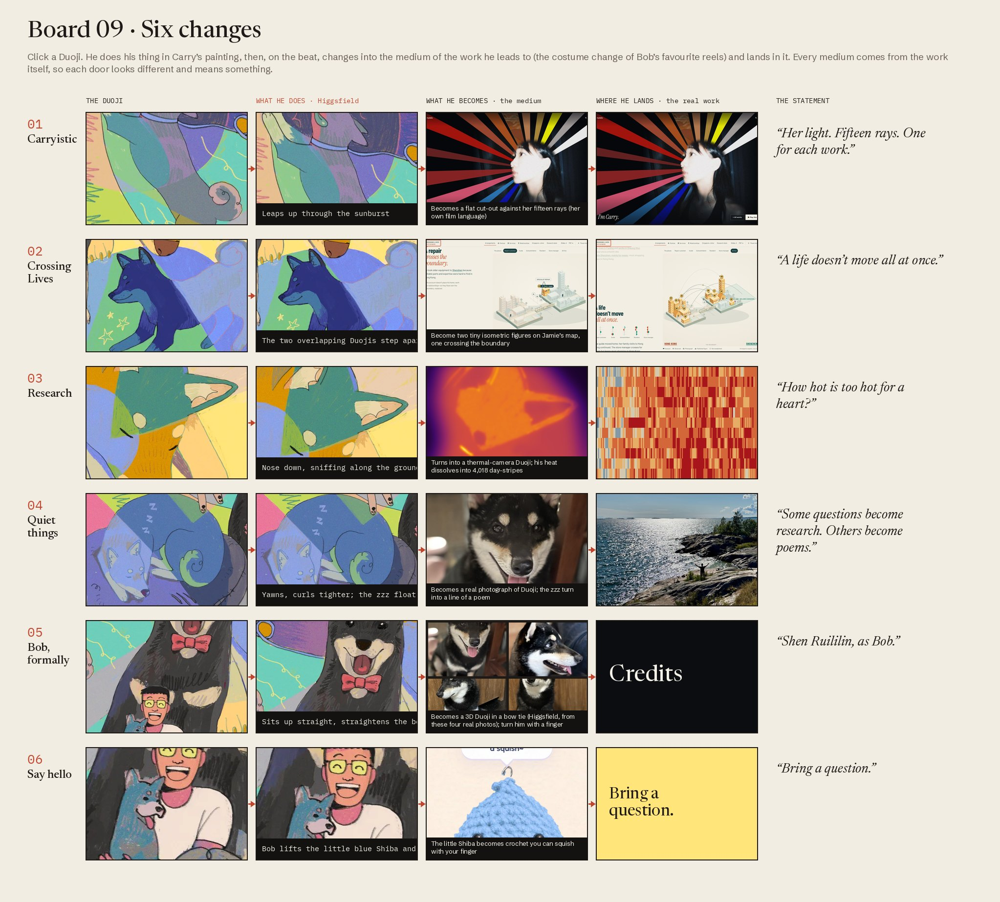
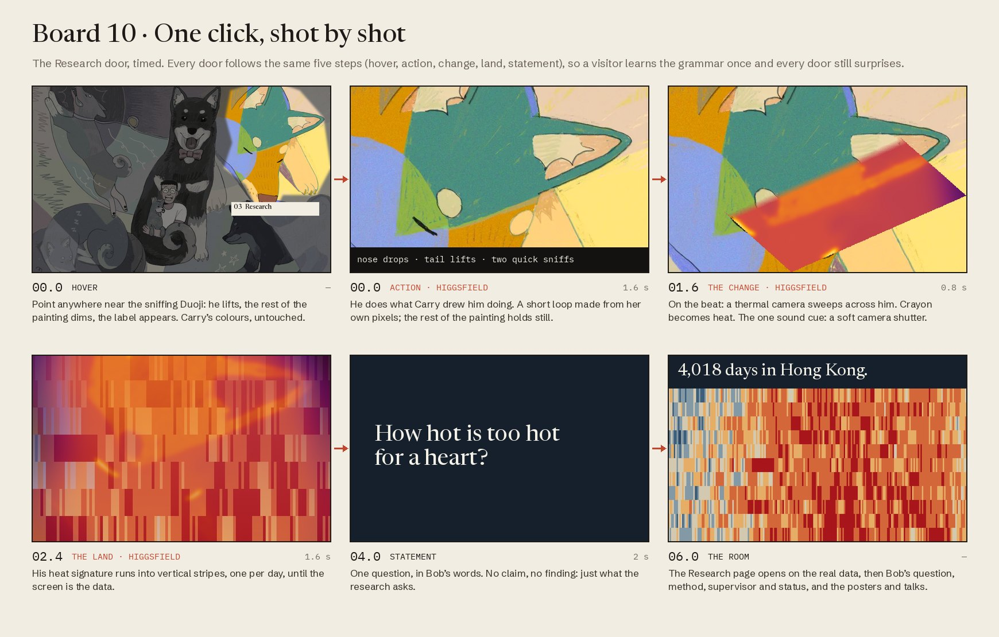
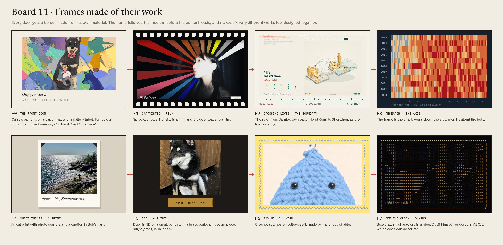
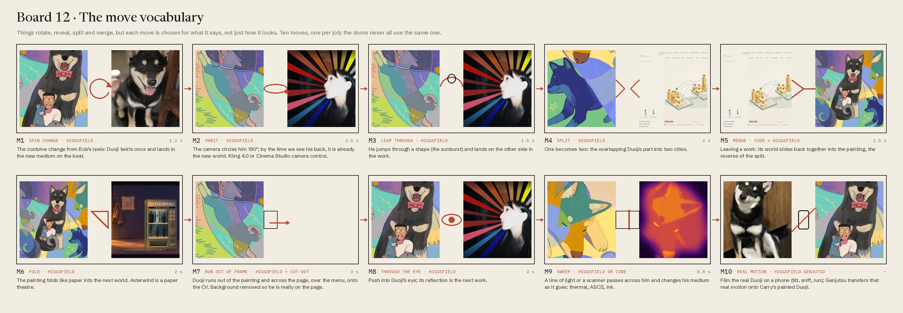
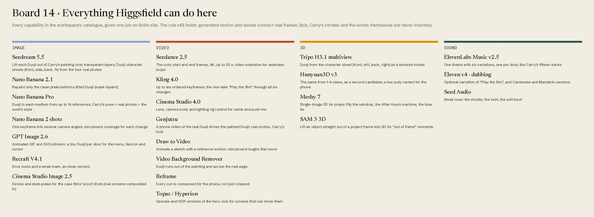
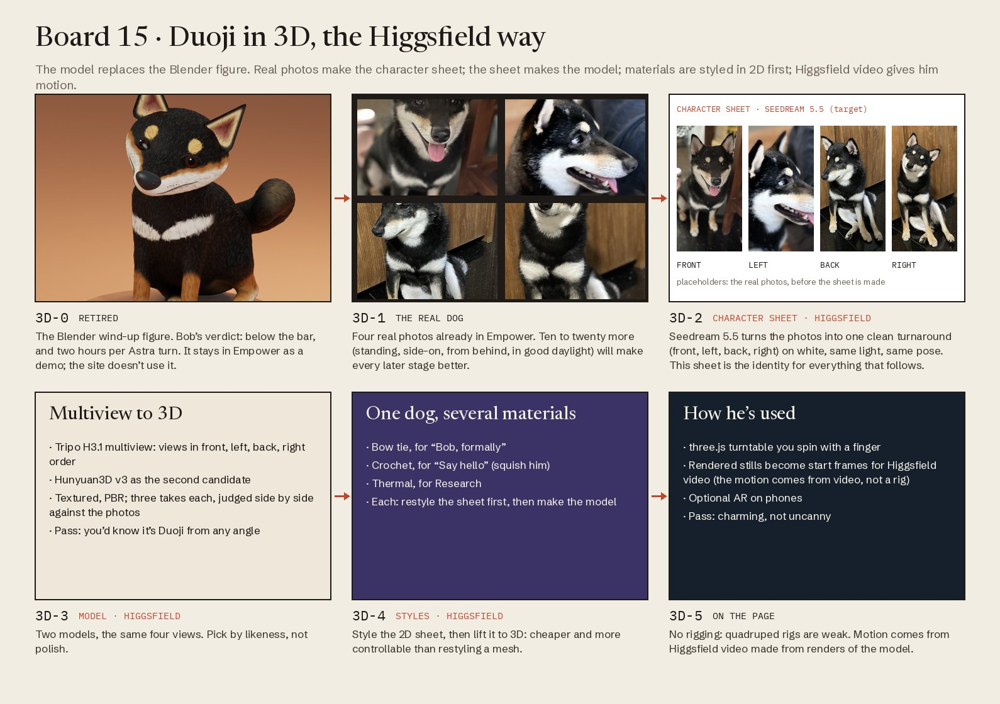
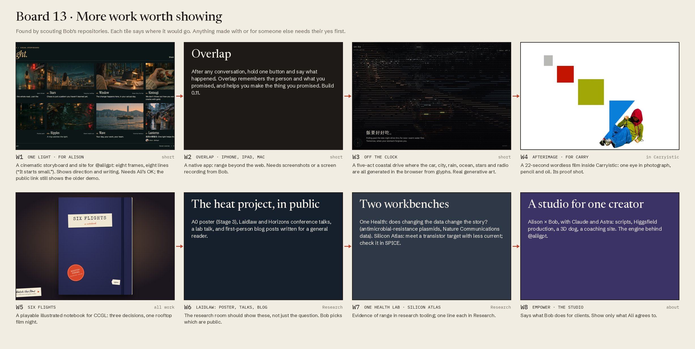

# Six changes

**Status, 27 November:** the third planning pass, written after Bob’s notes. Nothing is built or generated yet. It supersedes the line-drawing ideas in [storyboard-plan.md](storyboard-plan.md); that plan’s project ratings, case-film grammar and other rooms still stand.

## What changed, and why

- **Bob:** the line drawing looks cursed. → Carry’s painting stays **in full colour**, at the resolution we have. Clarity comes from focus (the Duoji you point at lifts and the rest dims), not from removing colour.
- **Bob:** use Higgsfield to make assets, with different borders. → Every door gets **a frame made of its own material** (Board 11). Higgsfield makes the Duoji variants, stickers, plates and 3D.
- **Bob:** show the Higgsfield cut-in; crazy transitions that rotate, reveal, merge; great statements. → A **move vocabulary** of ten (Board 12) and one statement per door (Board 09).
- **Bob:** click a Duoji, he runs or does something, then transforms, in a different art style each time. → This is the heart of the site: **six changes** (Boards 09–10).
- **Bob:** the Blender dog is cursed; use Higgsfield. → **Duoji in 3D**, made from his real photos through a Higgsfield character sheet and multiview 3D (Board 15).
- **Bob:** use everything Higgsfield can do. → **Board 14** gives every capability in the catalogue one job on the site.

## The idea in one line

**Click a Duoji. He does his thing in Carry’s painting, then, on the beat, changes into the medium of the work he leads to, and lands in it.**

It is the costume change (变装) of the taoagou reels Bob loves, with Duoji as the one who changes. Each medium comes *from the work itself*: Jamie’s isometric map, the heat data, the ASCII of *off the clock*, the crochet of Pocket Rain, Carry’s flat colour. So every door looks different, and every difference means something. Duoji is the constant. The site is professional because the grammar never changes: hover, action, change, land, statement.

## The six changes

| Door | What Duoji does (in Carry’s painting) | What he becomes | Where he lands | Move | Statement |
| --- | --- | --- | --- | --- | --- |
| **01 Carryistic** | Leaps up through the sunburst | A flat-colour cut-out against fifteen rays, Carry’s own film language | Carryistic’s landing | Leap through (M3) | *Her light. Fifteen rays. One for each work.* |
| **02 Crossing Lives** | The two overlapping Duojis step apart | Two tiny isometric figures on Jamie’s map; one crosses the boundary | Jamie’s page, “A life doesn’t move all at once” | Split (M4) | *A life doesn’t move all at once.* |
| **03 Research** | Nose down, two quick sniffs | A thermal-camera Duoji, whose heat dissolves into 4,018 day-stripes | Research room | Sweep (M9) | *How hot is too hot for a heart?* |
| **04 Quiet things** | Yawns, curls tighter, the *zzz* float up | A real photograph of Duoji asleep; the *zzz* become a line of a poem | Poems, photographs, the walk | Through the eye (M8) | *Some questions become research. Others become poems.* |
| **05 Bob, formally** | Sits up straight, straightens the bow tie | A 3D Duoji in a bow tie you can turn with a finger | Credits (the CV) | Orbit (M2) | *Shen Ruililin, as Bob.* |
| **06 Say hello** | Bob lifts the little blue Shiba and waves | The little Shiba becomes crochet you can squish | Contact | Spin change (M1) | *Bring a question.* |

**The front door line,** in Bob’s own words from his GitHub profile: *“I take a question that sounds abstract on a slide and give you a way to try it for yourself.”*

## One click, timed

| Step | Duration | What happens |
| --- | --- | --- |
| Hover | — | Instant, in code |
| Action | ~1.6 s | Higgsfield, played *in place* as a cut-out over the still painting |
| The change | ~0.8 s, on a beat | Higgsfield |
| The land | ~1.6 s | Higgsfield, ending exactly on the real work |
| Statement | 2 s | Typeset in code |
| The room | — | The work itself |

- **About six seconds** from click to work the first time. On the next visit, each change shortens to its last second.
- **Reduced motion** cuts straight to the statement.
- **On a phone,** the painting is a panorama you swipe across, one Duoji per screen (Board 04b). Tap to change.

## Frames made of their work

| Room | Frame |
| --- | --- |
| Front door | Paper mat and gallery label: *Duoji, six times · Carry · 2026 · commissioned by Bob* |
| Carryistic | Film sprockets |
| Crossing Lives | Jamie’s own Hong Kong–Shenzhen ruler |
| Research | The chart’s axes |
| Quiet things | A print with photo corners and a handwritten caption |
| Bob | A plinth with a brass plate |
| Say hello | Crochet stitches |
| *off the clock* | ASCII box-drawing characters |

Most of these are drawn in code (sharp at any size, light to load). Higgsfield makes the textured ones (yarn, brass, paper) as transparent PNG frames.

## The move vocabulary

| Move | Use | Made with |
| --- | --- | --- |
| Spin change | The costume change | Higgsfield |
| Orbit | | Kling 4.0 / Cinema Studio camera control |
| Leap through | | Higgsfield |
| Split | | Higgsfield |
| Merge | Leaving a work | Code + Higgsfield |
| Fold | Paper worlds | Higgsfield |
| Run out of frame | Duoji really crosses the page | Higgsfield + background removal |
| Through the eye | | Higgsfield |
| Sweep | Thermal, ASCII, light | Higgsfield or code |
| Real motion | The real Duoji’s phone video drives Carry’s painted Duoji | Genjutsu |

No two doors use the same move, and every move says something about its door.

## Every Higgsfield capability, one job each

**Image**
- *Seedream 5.5:* lift each Duoji out of Carry’s painting onto transparent layers; Duoji character sheets.
- *Nano Banana 2.1:* repaint the clean plate behind a lifted Duoji.
- *Nano Banana Pro:* Duoji in each medium, from Carry’s pose, real photos and the work’s style (up to 14 references).
- *Nano Banana 2 shots:* storyboard angles from one keyframe.
- *GPT Image 2.6:* animated GIF and SVG Duoji stickers for the menu, favicon and cursor.
- *Recraft V4.1:* door icons.
- *Cinema Studio Image 2.5:* device and desk plates for proof shots, with real screens composited in.

**Video**
- *Seedance 2.5:* cuts and seamless loops.
- *Kling 4.0:* a one-take *Play the film* through all six changes, from ten ordered keyframes.
- *Cinema Studio 4.0:* lens and lighting control.
- *Genjutsu:* the real Duoji’s motion on the painted one.
- *Draw to Video:* moving storyboard roughs.
- *Video Background Remover:* Duoji on the real page.
- *Reframe:* phone versions.
- *Topaz / Hyperion:* upscale and HDR.

**3D**
- *Tripo H3.1 and Hunyuan3D v3:* Duoji from his character sheet.
- *Meshy 7 and SAM 3:* props lifted out of works (Pip, the After Hours machine).

**Sound**
- *ElevenLabs Music:* a theme and six variations.
- *Eleven v4 and dubbing:* optional narration, with Cantonese and Mandarin versions.
- *Seed Audio:* small cues.

## Duoji in 3D, the Higgsfield way

1. **Retire the Blender wind-up figure** from the site. It stays in Empower as a demo.
2. **Real photos.** The four in `empower/projects/dog-3d/review/references` are a start. Ten to twenty more help: standing, side-on, from behind, in daylight.
3. **Character sheet.** Seedream 5.5 makes one clean turnaround (front, left, back, right), same light, same pose. This sheet becomes Duoji’s identity for everything.
4. **Model.** Tripo H3.1 multiview and Hunyuan3D v3 from the same four views, three takes each, picked by likeness from every angle.
5. **Materials.** Restyle the *sheet* first (bow tie, crochet, thermal), then lift each to 3D. It is cheaper and more controllable than restyling a mesh.
6. **Motion from video, not rigging.** Renders of the model become start frames for Higgsfield video, because quadruped rigging is weak. On the page he is a three.js turntable you spin with a finger.

## More work worth showing

Found by scouting the repositories.

| Work | Where it goes | Needs |
| --- | --- | --- |
| **One Light** (storyboard and site for Alison / @aliigpt) | Short film | Ali’s yes; the public link still shows the older demo |
| **Overlap** (native iPhone, iPad and Mac app) | Short film | Screenshots or a screen recording from Bob |
| **off the clock** (generative ASCII coastal drive) | Short film | — |
| **Afterimage** (22-second film for Carry) | Proof shot inside Carryistic | — |
| **Laidlaw poster, conference talks and blog** | Research | Bob picks what is public |
| **One Health Lab** and **Silicon Atlas** | One line each in Research | — |
| **Empower**, the studio | About: what Bob does for clients | Ali’s yes |
| **Six Flights** | All work | — |

## Production order (for Astra)

Each stage is checked before the next starts. Masters stay out of git; screen copies and a ledger go in.

| Stage | What | Models | Pass |
| --- | --- | --- | --- |
| 0 | Inputs: Carry’s painting (the 42 MB file if Bob uploads it), Duoji photos, captures of each work | — | — |
| 1 | Separate: six Duoji layers, Bob, a clean plate | Seedream 5.5, Nano Banana 2.1 | Not one of Carry’s strokes changes |
| 2 | Duoji character sheet from real photos | Seedream 5.5 | Bob says “that’s him” |
| 3 | Style keyframes: Duoji in each door’s medium, in his painting pose | Nano Banana Pro, GPT Image 2.6 | Reads as both Duoji and the work’s medium |
| 4 | Action loops, played in place | Seedance 2.5, or Genjutsu with real footage | Carry’s lines don’t swim |
| 5 | Change and land clips: action end → style keyframe → real work frame | Seedance 2.5, Kling 4.0 | Ends exactly on the real frame |
| 6 | 3D Duoji and materials | Tripo H3.1, Hunyuan3D v3 | Charming from every angle |
| 7 | Frames, stickers, icons | GPT Image 2.6 (GIF/SVG), Recraft, Seedream (transparent) | Consistent at 32 px and at full size |
| 8 | Score and cues | ElevenLabs Music, Seed Audio | Sits under the cuts |
| 9 | Phone versions and upscales | Reframe, Topaz | Composed for the phone, not cropped |

**First three tests,** before any volume:
1. **Research, end to end.** Sniff action → thermal change → stripes land. If this works, the method works.
2. **The character sheet.** Is it Duoji?
3. **Genjutsu.** Does a ten-second phone clip of the real Duoji move the painted one convincingly?

## Questions for Bob

1. **Duoji videos.** Can you film him on your phone, about ten seconds each, steady camera, plain background if possible: a head tilt, a sniff along the floor, a run toward you, a yawn and curl? They drive the painted Duojis (Genjutsu) and the 3D model.
2. **More photos.** Ten to twenty more: standing side-on, from behind, and one of him asleep (for door 04).
3. **Carry’s yes,** now covering more: lifting the Duojis out of her painting, animating them, and the six changes. Credit line for the mat: is “Carry · 2026 · commissioned by Bob” right?
4. **The six changes.** Does each medium feel right? Swap any (for example, a pixel-art change for the room or *The Day the Letter Came*).
5. **Ali’s yes** for One Light and Empower; screenshots of Overlap.
6. **Who comes first**: admissions, clients or supervisors? It decides which door is 01.
