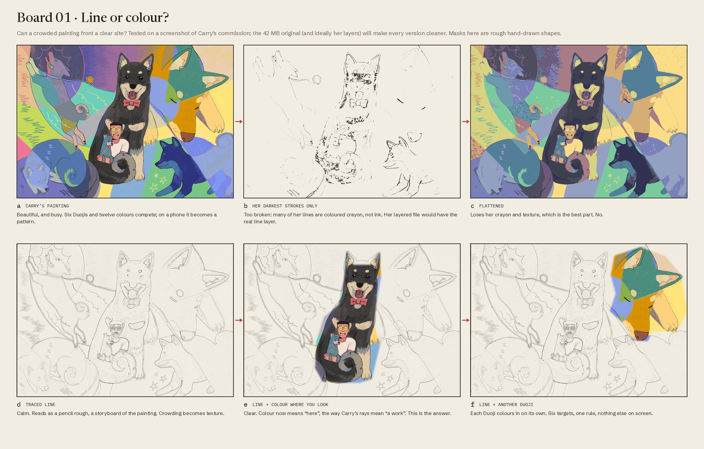
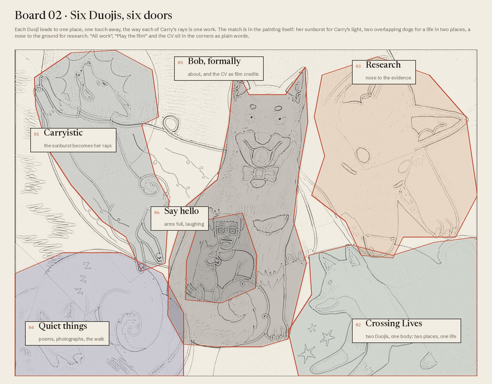
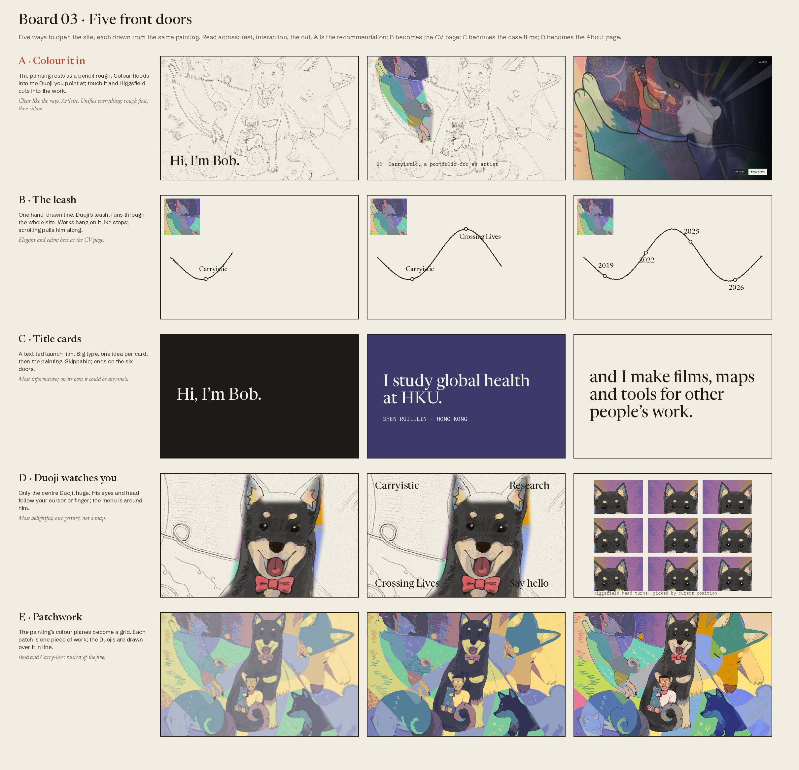
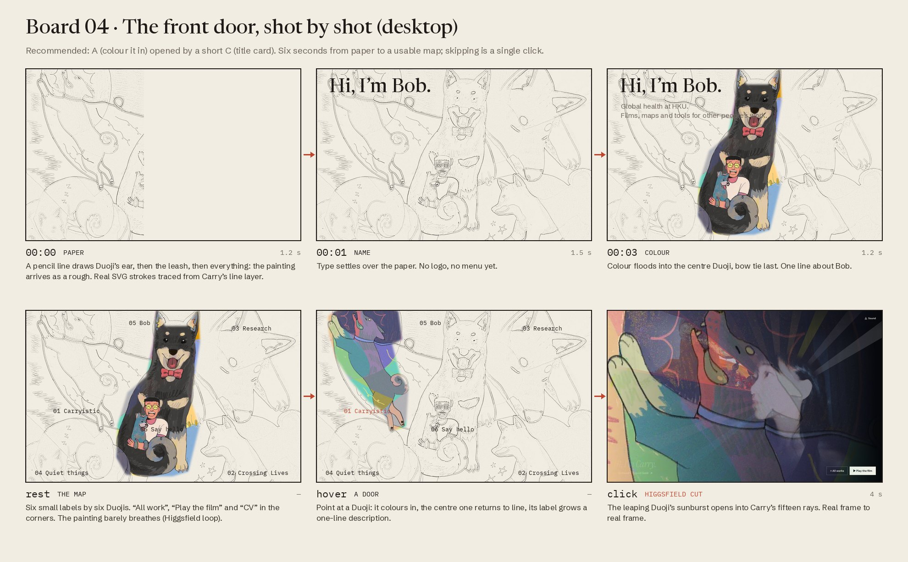
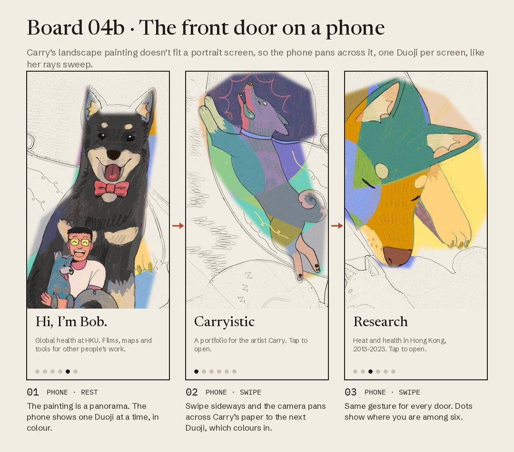
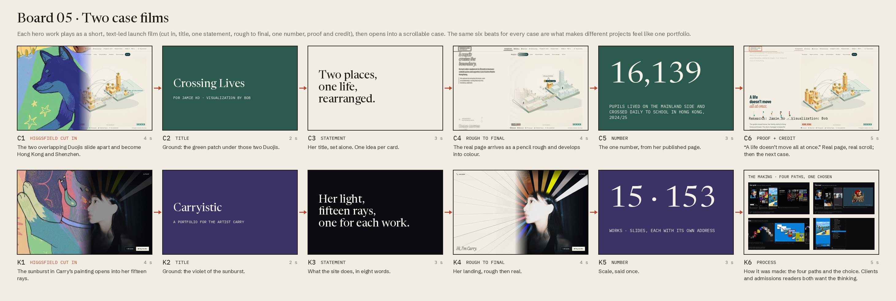
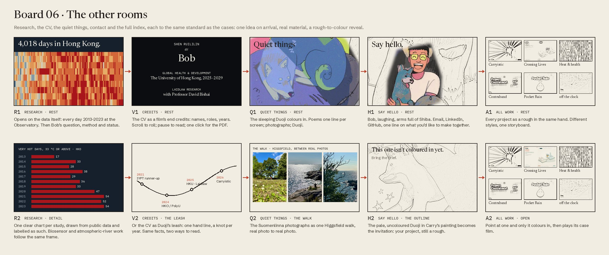
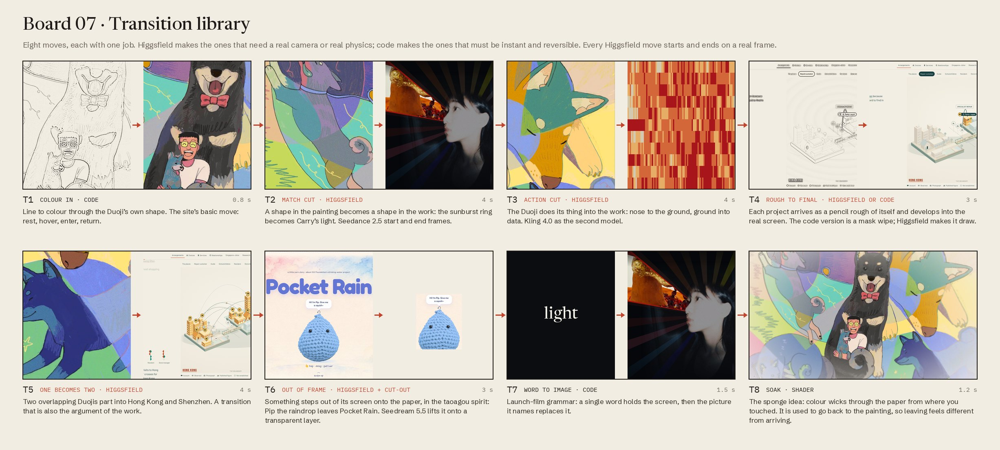
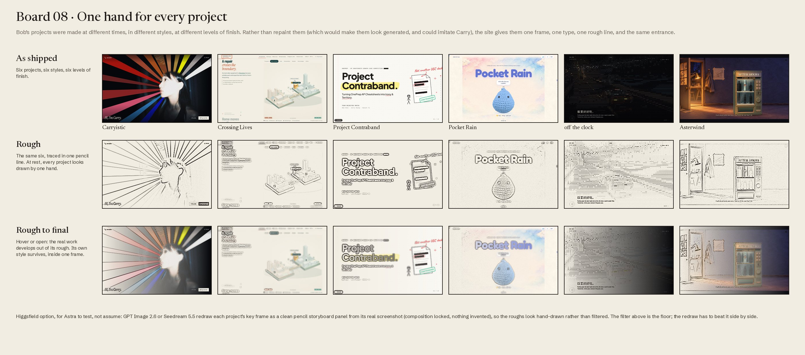

# The storyboard plan

**Status, 27 November:** planning and boards only, for Bob to react to. Nothing is built. This replaces the first pass in [drawing-board.md](drawing-board.md), which stays as the record of the research. Every board was made from real material: a screenshot of Carry’s commission (the 42 MB original will be cleaner) and captures of Bob’s live projects.

## 1 · What the site has to do

| When | A visitor should… | How the site does it |
| --- | --- | --- |
| **The first 3 seconds** | Feel something and remember it | Carry’s painting arriving as a pencil rough, then colour flooding into Duoji |
| **10 seconds** | Know who Bob is and what he does | *Hi, I’m Bob.* and one line: global health at HKU; films, maps and tools for other people’s work |
| **1 minute** | Have seen two pieces of real work, and be able to say what Bob did in them | Two hero case films, one touch from the front door |
| **5 minutes** | Trust him: research, record, range | Research, the CV as credits, and *All work* |
| **Next week** | Recall “the one with the Shiba painting that plays like a film” | One character, one rule (rough, then colour), one way of moving |

**Who it must win:** admissions readers, people who might hire Bob to build, and research supervisors. Bob still needs to say which comes first.

## 2 · Principles

1. **One idea per screen.** Carry’s rays work because there is one device and nothing else. Launch films (Bob named Anthropic’s and Kimi’s) work the same way: one statement, one picture, one number.
2. **Colour means “here”.** The resting state is quiet: line on paper. Colour appears where the visitor’s attention is. This solves the crowded painting and unifies every project at once.
3. **Wild picture, familiar structure.** First impressions form within about 50 ms, and simple, familiar layouts are judged most appealing ([Tuch et al., 2012](https://research.google.com/pubs/archive/38315.pdf)). The creativity goes in the art and the cuts; the navigation stays obvious.
4. **Real work, one frame.** Projects are shown as they are, inside the same panel, type and entrance. They are never repainted into looking generated.
5. **Every transition explains something.** A cut should show *why* two things connect (sunburst → Carry’s light; two dogs → two cities), not just look good.
6. **Fewer, better.** Two heroes, a handful of shorts, and an honest index for the rest.

## 3 · The crowded painting: line or colour?

- **The painting as it is** (a) is too busy to navigate.
- **Pulling out only Carry’s darkest strokes** (b) breaks up, because many of her lines are coloured crayon.
- **Flattening the colours** (c) destroys her texture.
- **A traced line** (d) turns the painting into a storyboard rough, and **colour only where you look** (e, f) is as clear as Carry’s rays.

**Ask Carry for her layered file.** Most illustrators keep a separate line layer. If she has one, the rough is *her own line*, and each Duoji can be lifted out cleanly. If not, Higgsfield can do both (section 10).

## 4 · Six Duojis, six doors

| Door | Duoji | Goes to | Why this Duoji |
| --- | --- | --- | --- |
| 01 | Leaping at the sunburst | **Carryistic** | Carry painted a sunburst; her site is rays of light. A match cut she already drew. |
| 02 | Two Duojis sharing one body (solid and outline) | **Crossing Lives**, Jamie Ko’s research | Two places, one life |
| 03 | Nose to the ground | **Research**: heat and health, and more | Following the evidence |
| 04 | Asleep | **Quiet things**: poems, photographs, the walk, Duoji | Rest |
| 05 | Centre, in the bow tie | **Bob, formally**: about, and the CV as film credits | The bow tie is the professional note |
| 06 | Bob himself, laughing, arms full of Shiba | **Say hello** | The human contact point |

*All work*, *Play the film* and *CV (PDF)* sit in the corners as plain words, like Carry’s *All works* and *Play the film*.

## 5 · The front door

| Option | Strength | Weakness | Verdict |
| --- | --- | --- | --- |
| **A · Colour it in** | Clear, artistic, one rule for the whole site | Needs clean Duoji shapes (Carry’s layers or Higgsfield cut-outs) | **The front door** |
| **B · The leash** | Elegant, calm, reads as a timeline | Abstract as a first screen | **Becomes the CV** |
| **C · Title cards** | Most informative; Anthropic/Kimi spirit | On its own, anyone’s site | **Opens the front door** (6 s) and **runs the case films** |
| **D · Duoji watches you** | Most delightful; taoagou spirit | One gesture, not a map | **Lives inside A** (the centre Duoji’s gaze) and on About |
| **E · Patchwork** | Bold, Carry-like | Busiest | Not used |

**On a phone,** Carry’s landscape painting becomes a panorama. One Duoji fills the screen in colour; swipe and the camera pans across her paper to the next one, which colours in. This is the same rhythm as Carry’s ray sweep, and there is no crowding at all.

## 6 · The projects, honestly

Ratings are 1–5 from the live sites as captured on 27 November. Bob knows things the screenshots don’t, so these are a starting point.

| Project | What it is | Idea | Craft | Substance | Verdict |
| --- | --- | --- | --- | --- | --- |
| **Carryistic** | A portfolio film for an artist | 5 | 5 | 4 | **Hero.** Door 01. |
| **Crossing Lives** (Jamie Ko) | Research told as an illustrated map, with real counts | 5 | 5 | 5 | **Hero.** Door 02. Its own lines (“A repair crosses the boundary”) are already launch-film cards. |
| **Heat & health** (Laidlaw) | Undergraduate research with Prof. David Bishai | 4 | — | 5 | **Hero of Research.** It has no visual yet, so the site makes one from public HKO data, labelled as context, not findings. |
| **Project Contraband** | Case-competition pitch, with Jerry Huang and Daniel Yu | 4 | 4 | 3 | **Short film.** Witty, well-designed deck. |
| **Pocket Rain** | GX Foundation drinking-water story, with Pip the crochet raindrop | 4 | 4 | 3 | **Short film.** Charming, and part of the water thread. |
| **off the clock** (GTA-ASCII) | An ASCII night city with small lines of care (“饭要好好吃。”) | 4 | 4 | 2 | **Short film**, or Quiet things |
| **Asterwind** | Leadership paper theatre (group project) | 4 | 3 | 3 | All work. Its characters look generated. |
| **The Day the Letter Came** | Pixel family story: Ningbo, Hong Kong, Shanghai | 4 | 3 | 3 | All work, or Quiet things (personal) |
| **Six Flights** | Course notebook with short films | 3 | 3 | 3 | All work |
| **Career Atlas** · **RegLens** · **NEWDAY** · **Crossing Lives (game)** · **Bob’s Room** | Tools, research tooling, experiments | 3 | 2–3 | 2–4 | All work. RegLens can also be named in Research. |
| **Biosensor (BIOC1600)** · **AERIS-HK** · **Silicon Atlas** · **One Health Lab** | Research repositories | — | — | 3–4 | Named in Research if Bob wants them |
| **Sidequest Atlas** · **Merey’s atlas** · **MCAT–GAMSAT** · **My-Life** · **LINK-S** | Personal or private | — | — | — | **Out.** Private, or made for one person. |

**The shape:** 2 heroes + research + 3 shorts + an index. That is about six pieces a visitor actually sees, which is where Carry’s clarity comes from.

## 7 · Case films: one grammar for every project

Six beats, always in this order: **cut in** (Higgsfield) → **title** → **one statement** → **rough to final** (the real work) → **one number** → **proof, credit and the making**. It is about 20 seconds and skippable. Then the page becomes a scrollable case: the brief, the idea, the making (Bob’s storyboards and paths), the result and the links. Shorts use the same six beats in about 10 seconds.

**Type for the cards:**
- **Newsreader** (display serif, optical sizes) for statements.
- **Schibsted Grotesk** for reading.
- **IBM Plex Mono** for the storyboard marks: panel numbers, timings, credits.

All are free and self-hostable. They are used on these boards so Bob can judge them. The type is deliberately not Carry’s (Instrument Serif) and not Astra’s editorial look (Fraunces on cream).

## 8 · The other rooms

- **Research.** It opens on 4,018 days of Hong Kong heat, then Bob’s question, method and status. One clear chart per study, always drawn from public data and labelled.
- **Credits.** The CV as a film’s end credits, which are just a beautiful list: names, roles, years. Scroll to roll, pause to read, one click for the PDF. Or the same facts on Duoji’s leash (Board 03, B).
- **Quiet things.** Poems, one line per screen; the Suomenlinna walk as one Higgsfield film between real photographs; Duoji.
- **Say hello.** Bob, laughing with his arms full of Shiba. And the pale, uncoloured Duoji in Carry’s painting as the invitation: *This one isn’t coloured in yet. Bring the brief.*
- **All work.** Every project as a rough in the same hand. Point at one, and only it colours in.

## 9 · Transitions

| | Move | Made with | Used for |
| --- | --- | --- | --- |
| T1 | Colour in | Code (mask in the Duoji’s shape) | Rest, hover, return |
| T2 | Match cut | Higgsfield (Seedance 2.5) | Sunburst → Carry’s light |
| T3 | Action cut | Higgsfield (Kling 4.0) | Nose to the ground → heat data |
| T4 | Rough to final | Higgsfield, or code as the fallback | Every project’s entrance |
| T5 | One becomes two | Higgsfield | Two Duojis → Hong Kong and Shenzhen |
| T6 | Out of frame | Higgsfield + Seedream cut-out | Pip leaves Pocket Rain; the little Shiba runs out of Bob’s arms (the taoagou spirit) |
| T7 | Word to image | Code | Case-film cards |
| T8 | Soak | Code (paper shader) | Going back to the painting: the sponge, without SpongeBob |

**Rules:**
- Code moves last under a second and can be reversed.
- Higgsfield moves last about 4 seconds and play once per visit, then shorten to their last second.
- Every Higgsfield move starts and ends on a real frame.
- Reduced motion turns them all into cuts.

## 10 · One hand for every project

The projects differ in style and finish. **Don’t repaint them; frame them.** At rest each appears as a rough in one pencil line, and on entry its real self develops out of the rough.

The automatic trace (row 2) works for picture-led projects (Carryistic, Crossing Lives, Asterwind) and badly for text-heavy ones (Contraband) and for the ASCII city. That is exactly the case for a Higgsfield redraw: Astra tests one against the filter side by side.

## 11 · House style

- **Paper and ink.** Paper `#f2ede3`, ink `#1d1a17`, one red for marks `#c4452d`.
- **Colour comes only from Carry’s painting,** one colour per door:

  | Door | Colour |
  | --- | --- |
  | Carryistic | sunburst violet `#9985ab`, deepening to `#3b3266` |
  | Crossing Lives | teal `#6dcfba` and the green patch |
  | Research | Duoji orange `#d99202` |
  | Quiet things | periwinkle `#8ea1dd` |
  | Bob | bow-tie red `#bc5f62` |
  | Say hello | yellow `#ffe57a` and pink `#eb769b` |

- **Line.** A pencil rough everywhere at rest.
- **Grain.** A little paper texture, nothing else.
- **Motion.** Calm. Code moves ease out in under a second; Higgsfield moves read as camera, not effect.
- **Sound.** Off until asked for. One theme with a variation per door, like Carry’s fifteen tracks.

## 12 · What Higgsfield is for: goals for Astra

| Capability | Goal | Models | Pass if |
| --- | --- | --- | --- |
| **Image · separate** | Lift each Duoji and Bob out of the 42 MB painting onto transparent layers; fill the clean plate behind | Seedream 5.5 (transparent), Nano Banana 2.1 (inpaint) | Not one of Carry’s strokes changes. Only needed if she has no layers. |
| **Image · line** | A clean vector line drawing of the painting, so the rough can *draw itself* | GPT Image 2.6 (SVG), Recraft V4.1 vector | Beats Board 01 (d) side by side. Her line layer beats both. |
| **Image · roughs** | Each project’s key frame redrawn as a pencil storyboard panel, composition locked | GPT Image 2.6, Seedream 5.5 | Beats Board 08 row 2; nothing invented |
| **Video · living painting** | Six short loops: breathing, a swinging leash, twinkling stars, a sniff | Seedance 2.5, Kling 4.0 | Carry’s lines don’t swim |
| **Video · gaze** | The centre Duoji’s head following the cursor (a grid of turns) | Seedance 2.5 start and end frames | Reads as the same painting in every frame |
| **Video · cuts** | T2, T3, T5, T6 and the door cuts for Quiet things, Bob and Say hello | Seedance 2.5, Kling 4.0, MiniMax H3 | Each says *why* two things connect |
| **Video · rough to final** | Each hero and short draws itself, then colours in | Seedance 2.5 | Ends exactly on the real frame |
| **Video · the walk** | Bob’s Suomenlinna photographs as one walk | Kling 4.0 keyframes, FLUX 3 Video | Only after Bob confirms it was one afternoon |
| **3D** | A Duoji figure to turn on About; Pip as a squishable 3D drop | Meshy 7, Tripo H3.1, Hunyuan3D v3 | Charming, not uncanny. Quadruped rigging is weak, so a turntable. |
| **Audio** | A theme and six variations | ElevenLabs Music v2.5 | Sits under the cuts without announcing itself |

**First five tests,** before anything else is generated:
1. One living Duoji.
2. The sunburst → rays cut.
3. The gaze grid.
4. One rough to final (Crossing Lives).
5. The 3D Duoji.

## 13 · Not doing

- **Generating new art “in Carry’s style”.** New Duoji poses should be drawn by Carry.
- **Doraemon or SpongeBob characters.** We use their ideas instead: a door to anywhere, a pocket of everything, a sponge that absorbs everything.
- **Repainting Bob’s projects** to make them match.
- **Showing a project without its credits,** or a public-data chart as if it were a finding.

## 14 · Questions for Bob

1. **The 42 MB original.** Drop it in Google Drive (this session can read Drive) or add it to the repo. And ask Carry: is there a layered file with a separate line layer?
2. **Carry’s yes** to the painting being traced, separated, animated and made 3D, and maybe drawing two or three extra Duoji poses (paid).
3. **The six doors.** Do they map right for you? Is the pale outline Duoji anyone in particular?
4. **The shorts.** Contraband, Pocket Rain and *off the clock*: yes, no or swap? Anything missing that you’re proud of?
5. **The films you meant.** Send links to the Anthropic and Kimi films (“IPO films”: launch films?). The Kimi one I couldn’t pin down.
6. **Who comes first**: admissions, clients or supervisors?
7. **Your one line.** The draft is “I study global health at HKU, and I make films, maps and tools for other people’s work.”
