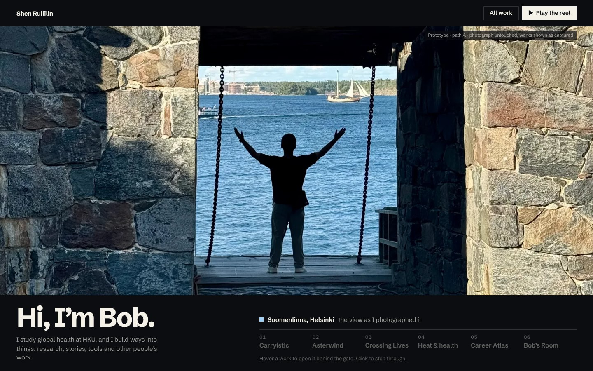
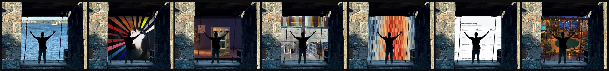
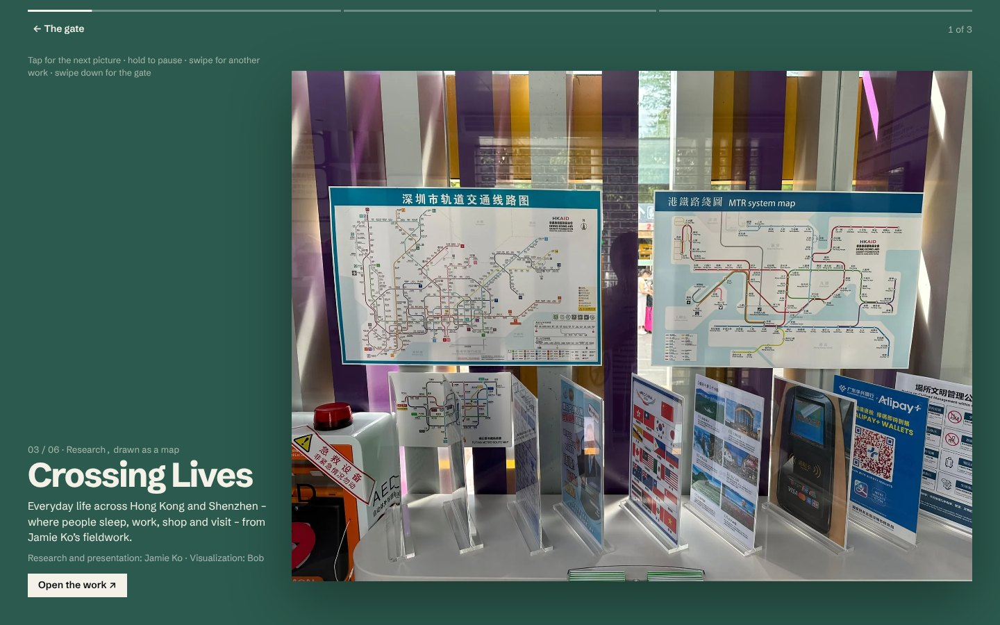
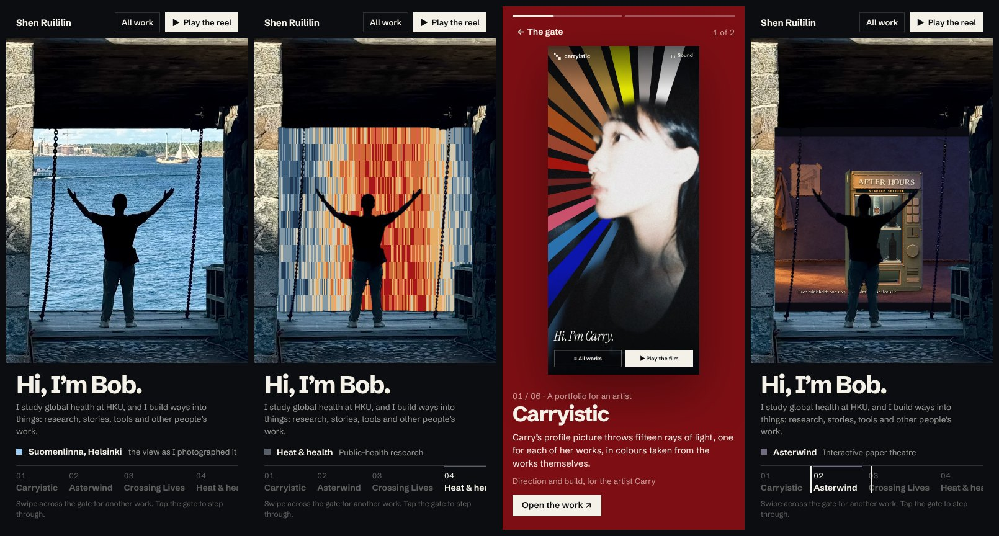
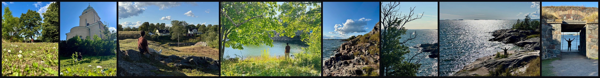

# Where Bob’s site goes next

**Status, 27 November:** a direction for Bob to choose, plus a working prototype of the recommendation. Nothing on the live site has changed. [Prototype](../lab/doorway/) · Walkthroughs: [desktop](paths/doorway-desktop.mp4) · [phone](paths/doorway-phone.mp4) · [Higgsfield handoff for Astra](higgsfield-requests.md)

## What we heard

- **Bob:** the site needs a major revamp now that we have Higgsfield. It is too heavy on looking generated. It has to sell him, and it has to be at least as good as Carry’s.
- **Bob, later:** we have near-unlimited Higgsfield, and he wants to genuinely do something with it.

Those two notes only look like they disagree. Carry’s site shows how they fit together. It uses a lot of generated motion, and none of it reads as generated, because every generated shot starts and ends on something real.

## Three sites, side by side

| | Carry’s site | The live room (`main`) | Astra’s editorial (`astra-room-reimagined`) |
| --- | --- | --- | --- |
| **Front door** | Her own profile picture | A generated pixel illustration | Fraunces headline, with the generated pixel room in an arch |
| **The idea comes from** | Her work: one ray per work, coloured from that work | A cosy game room, a genre many AI sites share | A warm-paper editorial template |
| **First screen shows the work** | All fifteen works, one touch each | Hidden behind objects and twelve checkpoints | Four projects, one at a time, below the fold |
| **Biggest real image** | Her face, full screen | None | A tilted polaroid near the bottom |
| **Words** | Three phrases | Many labels and controls | Many sentences that could describe anyone (“Questions that became something”) |
| **Generated media** | Bridges *between* her real frames | Is the frame | Still the two largest images |

**Astra’s direction** is a real improvement in one way. You learn who Bob is in one line, and the work is a click away. But it moves towards safe rather than towards Bob. Its look (cream paper, green ink, rust accent, Fraunces italics) is the default portfolio of 2026, and its two largest pictures are still generated. Nothing on that page could only be Bob’s.

**Carry’s bar** is four rules, and they apply to Bob too:
1. The front door is the person’s own picture, untouched.
2. The idea comes out of their own material.
3. Every work is on the first screen, one touch away, with its own address.
4. Generated motion connects real frames. It never stands in for the person or the work.

## The idea: the gate

Bob’s best photograph is already a front door. He stands in a stone gateway on Suomenlinna with his arms open and the sea behind him. The opening is almost a perfect screen.

**The gate opens anywhere.** The stone, the chains and Bob stay exactly as photographed. Behind him, the view changes to each of his works. It is Doraemon’s Anywhere Door, which is already in his room, and it fits how he works: he builds ways into other people’s worlds (Carry’s, Jamie’s, his HKU group’s) and into his own questions.

| | What it does |
| --- | --- |
| **Landing** | The photograph comes first. Then the gate quickly opens onto every work in turn and settles back on the sea. The words: *Hi, I’m Bob.*, one line, *All work*, *Play the reel*. |
| **Choosing** | Desktop: hover a work, or move the pointer across the opening, and the view behind Bob wipes to that work. Phone: swipe across the gate. Keyboard: arrow keys. |
| **Stepping through** | Click or tap the gate. The camera flies through the opening, past Bob’s raised arm, and the work settles onto its own colour. |
| **Inside a work** | It plays like stories, the same grammar as Carry’s reel. Tap for the next picture, hold to pause, swipe for the next work, swipe down to return to the gate. Every work has its own address (`#crossing`, `#crossing/2`). |
| **The letterbox** | A black band above and below, sampled from the shadow under the gate’s lintel. It makes the site a film, and it keeps all text off the photograph. |
| **Type** | Schibsted Grotesk, one family, self-hosted. It is plain and confident, and nothing like Carry’s serif. |

### Nothing behind the gate is invented

- **Carryistic, Asterwind, Crossing Lives, Career Atlas and the room** are shown as captured from the live sites. Crossing Lives opens on Bob and Jamie’s field photograph of the two transit maps.
- **Heat and health** is drawn from data, not an illustration. Each stripe is one day’s maximum temperature at the Hong Kong Observatory, 2013–2023 ([HKO open data](https://data.weather.gov.hk/weatherAPI/opendata/opendata.php?dataType=CLMMAXT&rformat=csv&station=HKO)). The second picture counts the very hot days (33 °C or above), which rise from 17 in 2013 to 54 in 2023. Both are labelled as public observations, not findings from Bob’s study.
- **The pixel room** stays, as door 06, where it is one of the things Bob made rather than the front door.

### How the gate is built

`scripts/prepare-doorway.py` cuts the view out of the 1920 × 2560 original from Bob’s published Suomenlinna walk. Bob, both chains, the railing and the stone stay as photographed. The view sits *behind* that cut-out. So anything played in the opening (a still, the data, a generated clip) is masked by the real Bob automatically, and no generated pixel ever lands on him. `lab/doorway/media/motion.json` has a slot for every Higgsfield clip, and the page uses a clip as soon as its slot is marked ready.

## What Higgsfield does here

This is where the near-unlimited Higgsfield goes. There are four kinds of shot, about twenty-five in all, with three takes each. The details for Astra are in [the handoff](higgsfield-requests.md).

| | Shots | What they are | Why they won’t read as generated |
| --- | --- | --- | --- |
| **L · The gate, alive** | 1 | The sea, the sky and the light move behind Bob; the boats hold. A loop under the landing. | Only the opening is used; everything else is the photograph. |
| **G · Through the gate** | 6 | The view behind Bob turns into each work: the low sun splits into Carry’s fifteen rays; dusk folds the sea into Asterwind’s paper studio; the far shore slides in and becomes the two transit maps; the water’s glitter hardens into the HKO day stripes; the horizon becomes a ruled line and Career Atlas prints in; night falls and the room’s lanterns come up. | Start: the real photograph. End: the real work in the gate. Bob is composited from the photograph throughout. |
| **E · Step through** | 6 × wide and tall | One steady dolly through the gate, past Bob’s raised hand, landing full frame on the work. Replaces the code-built zoom. | Starts on the gate with the real work in it, ends on the real work. |
| **W · The walk** | 1 film, 2 aspects | Bob’s seven other Suomenlinna photographs as ordered keyframes, from the daisies to the church, the rocks, the shore, the boat in the branches and the arms-wide rocks, landing at the gate. About 30 seconds. It plays as *Play the film*, and its last four seconds are the first-visit arrival. It picks up the idea of Bob’s first site, *Let’s take a walk*. | Eight real photographs are the keyframes; the model only walks between them. |

What stays unmade: Bob’s face, other people, and the works themselves. The works get real screen recordings (R in the handoff), captured from the live sites in 4K, so the reel shows the work moving as it actually moves.

## Other paths considered

- **B · The walk first.** The 30-second walk is the landing, and the works sit along the route as places Bob passes. It is the most Higgsfield-heavy option and very beautiful. But it puts a film between a visitor and the work, which is exactly Carry’s first complaint about her version 1 (“so many steps”). In path A, the walk is one tap away instead.
- **C · Astra’s editorial, cleaned up.** Keep the editorial page, replace the arch with the gate photograph and the Asterwind illustration with captures. It is the quickest option and the safest. It would be clean, but it would look like everyone else’s portfolio. This is the version to choose if the site has to stay a page that reads top to bottom.
- **D · Keep the room as the front door** and tune it. It is still the most “generated” front door of the three, and Bob already called that out.

## What is built and what is not

- **Built (prototype, `lab/doorway/`):** the gate, the six views, the overture, hover/swipe/keys, stepping through, the reel with its frames, colours and addresses, *All work* with an About block and links, reduced motion, and a `motion.json` slot for every clip. It is tested on 1440 × 900 desktop and 390 × 844 phone. `npm test` covers the gate geometry, every frame file, the clip slots and the HKO data.
- **Not yet:** sound; the real screen recordings; the walk; a replacement `index.html` (the prototype doesn’t touch the live site, `room.html`, `careers/` or `link-s/`); and copy Bob has approved. Every line in `works.mjs` is a draft.

## Questions for Bob

1. **Is the gate the right picture of you?** The alternative is arms wide on the rocks (`walk-2094`), but it has no frame to open.
2. **Do you have the original of the gate photo?** The published copy is 1920 × 2560. The phone original (likely 3024 × 4032) would let Higgsfield work at 4K without inventing detail.
3. **Were the seven walk photos taken on the same afternoon?** Your shirt differs between some of them. If it was a different day, the walk shouldn’t pretend it was one afternoon, and we’d cut it as chapters instead.
4. **Carry’s picture behind your gate.** Carryistic opens on her face. She should say yes before it is public.
5. **Your one line.** The draft is “I study global health at HKU, and I build ways into things: research, stories, tools and other people’s work.”
6. **The room:** keep it as door 06, or retire it to an archive link?

**One open question that could change the edit:** who does this site most need to persuade in the next six months: admissions readers, people who might hire you to build their site, or a research supervisor? The answer decides which work stands first behind the gate (Carryistic or heat and health), what *Play the reel* plays, and your one line.
